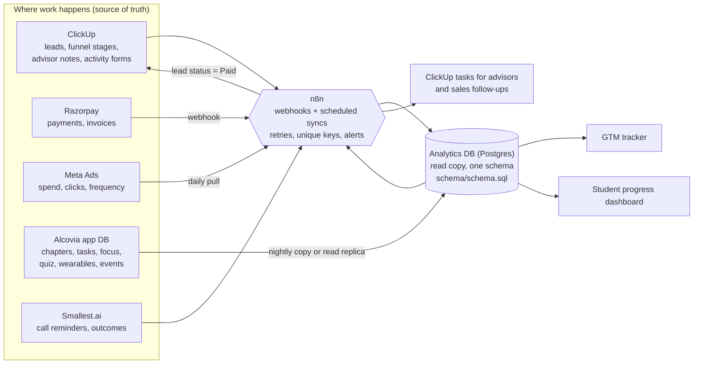

# Architecture: one connected system

Keep the tools Alcovia already uses for the work they are good at. Add one database for reporting. n8n moves data between them.

## What lives where

| Data | Source of truth | How it reaches the analytics DB | Unique key (stops duplicates) |
|---|---|---|---|
| Leads and funnel stages | ClickUp | n8n on ClickUp status change, plus a nightly full sync | ClickUp task id + phone hash |
| Payments | Razorpay | Webhook → n8n (workflow 01) | `razorpay_payment_id` |
| Ad performance | Meta Ads | Daily pull of the last 3 days (workflow 02) | `stat_date + ad_id` |
| Call reminders and outcomes | Smallest.ai | Webhook → n8n → ClickUp field → DB | call id |
| Student learning data | App DB | Read replica or nightly copy | app ids |
| Activities and ratings | ClickUp form | n8n | activity id + student id |

**Rules:**
- Nobody edits the analytics database by hand.
- To fix a number, fix it in the source system. The next sync corrects it.

## Making it not break

- **Duplicates:** every insert uses the unique key with `ON CONFLICT`. Webhook retries and re-runs are therefore safe.
- **Late or changed data:** Meta revises numbers for about 72 hours, so the daily sync re-pulls 3 days and overwrites them.
- **Failures:** each n8n node that calls an outside service retries 3 times. A failed run creates a ClickUp task for the engineer, so failures can't go unnoticed.
- **Freshness:** each dashboard shows a "data as of" time. A daily check flags any source that hasn't synced for 26 hours.
- **Reconciliation (weekly):**
  - Razorpay settlement total vs `payments` total.
  - Meta account spend vs `ad_daily` total.
  - ClickUp lead count vs `leads` count.
  - Any difference over 1% opens a task.
- **Access:**
  - Advisors see only their own students.
  - Parents see only their own child (planned).
  - Revenue pages are for the founder and the sales lead.
  - Wearable data is stored only with parental consent.

## Why not something bigger

At about 50 students and a few hundred leads a month, one Postgres database and n8n are enough. A separate data warehouse or event pipeline only makes sense when either of these happens:
- App events pass a few million rows a month.
- More than one team needs its own models.
